# Sơ đồ trình tự PetSpa

[Mở bản PDF có mục lục](output/pdf/SO-DO-TRINH-TU-CAP-NHAT-3.pdf) · Đối chiếu ngày 19/11/2026.

**Cách đọc.** Đọc từ trên xuống. Mũi tên liền là thao tác hoặc lời gọi, mũi tên nét đứt là dữ liệu trả về. Khung alt/else thể hiện các kết quả loại trừ nhau, opt là thao tác tùy chọn, par/and là các lệnh độc lập có thể chạy song song, loop là thao tác lặp.

**Phạm vi.** 43 sơ đồ bao phủ 30 use case gốc (24 bắt buộc, 6 mở rộng), các quy trình con theo góp ý, đăng nhập khách và luồng tổng hợp. “Quầy” gồm lễ tân và quản lý. OPS-22 tiếp nhận use case theo dõi phiên từ tài liệu gốc. BOOK-07 dành cho danh sách lịch đặt. WPF là thiết kế tích hợp cho client ở repo riêng.

**Trạng thái API.** “Đã có” đối chiếu với mã nguồn hiện hành. “Đề xuất” là hợp đồng cần triển khai. “Kết hợp” có cả thao tác đã có và thay đổi đề xuất, kể cả thay DTO hoặc siết quyền trên đường dẫn hiện có. E2E-01 tóm tắt thiết kế đích.

**Xác thực.** Hai API login trả accessToken, tokenType, expiresAtUtc, role và user (id, fullName, phone). Auth tra tài khoản ACTIVE qua kho Customer hoặc Operation hiện hữu và phát JWT. Chưa cấp refresh token. WPF gửi Bearer cho API cần quyền, khi token hết hạn và nhận 401 thì quay lại đăng nhập. Với 403, thông báo thiếu quyền.

**Ranh giới.** Server PetSpa là một ứng dụng ASP.NET Core. Cột module biểu diễn contract nội bộ cùng tiến trình. Nhãn PATCH trên lời gọi Billing sang Booking cho biết thao tác API tương ứng. Cột PostgreSQL chỉ thể hiện dữ liệu do module tương ứng quản lý. Những truy vấn nội bộ đơn giản được lược bớt khi hợp đồng HTTP là trọng tâm.

**Quyền hiện hành.** Màn hình theo actor của use case. Backend cho Customer sửa/thêm pet của mình, cho mọi tài khoản nhân sự ghi Resource và truy cập Booking, cho khách thao tác một số booking của chính mình. Các quyền này rộng hơn use case. Admin đăng nhập nội bộ và quản lý được hồ sơ khách, nhưng policy tra cứu rảnh/bận hiện chỉ nhận receptionist hoặc manager.

**Quyết định thiết kế.** PENDING là chờ tiếp nhận. CONFIRMED ghi nhận khách đã đến. COMPLETED là booking đã hoàn tất dịch vụ và đủ điều kiện lập hóa đơn. PAID là booking đã được thanh toán xong sau BILL-03. Quầy hủy qua BOOK-04. BOOK-06 chỉ tiếp nhận và chốt dịch vụ. Quầy tải các nhóm phiên dịch vụ mỗi 15 giây, nhân viên thăm dò thông báo mỗi 30 giây. Hai chu kỳ là mặc định đề xuất, có thể cấu hình. Tạm dừng khi rời màn hình tương ứng hoặc đăng xuất, bỏ nhịp nếu lệnh trước chưa xong.

## Mục lục

| Mã | Sơ đồ | Phạm vi | API |
| --- | --- | --- | --- |
| [AUTH-01](#auth-01) | Khách đăng nhập và mở trang cá nhân | Bổ sung | Đã có |
| [CUS-01](#cus-01) | Xem và sửa hồ sơ khách hàng | Bắt buộc | Đã có |
| [CUS-02](#cus-02) | Xem và cập nhật hồ sơ thú cưng | Bắt buộc | Kết hợp |
| [CUS-03](#cus-03) | Thêm khách hàng | Bắt buộc | Đã có |
| [CUS-04](#cus-04) | Thêm thú cưng cho khách | Bắt buộc | Kết hợp |
| [CUS-05](#cus-05) | Vô hiệu hóa khách hàng hoặc thú cưng | Mở rộng | Kết hợp |
| [CUS-06](#cus-06) | Đăng nhập tại quầy | Bắt buộc | Đã có |
| [RES-01](#res-01) | Xem và quản lý danh mục dịch vụ | Bắt buộc | Đã có |
| [RES-02](#res-02) | Tìm dịch vụ và chọn tùy chọn phù hợp | Bắt buộc | Đã có |
| [BOOK-01](#book-01) | Tạo lịch đặt | Bắt buộc | Kết hợp |
| [BOOK-02](#book-02) | Thay đổi dịch vụ trong lịch đặt | Bắt buộc | Kết hợp |
| [BOOK-03](#book-03) | Cập nhật thông tin lịch đặt | Bắt buộc | Kết hợp |
| [BOOK-04](#book-04) | Hủy lịch đặt tại quầy | Bắt buộc | Đề xuất |
| [BOOK-05](#book-05) | Tìm lịch đặt và mở chi tiết tại quầy | Bắt buộc | Kết hợp |
| [BOOK-06](#book-06) | Cập nhật trạng thái booking | Bắt buộc | Đề xuất |
| [BOOK-07](#book-07) | Xem tổng hợp các lịch đặt | Quy trình con | Kết hợp |
| [OPS-01](#ops-01) | Quản lý phòng | Mở rộng | Đề xuất |
| [OPS-02](#ops-02) | Xem, thêm, sửa và ngừng sử dụng nhân viên | Mở rộng | Đề xuất |
| [OPS-03](#ops-03) | Xem toàn bộ ca làm | Mở rộng | Đề xuất |
| [OPS-04](#ops-04) | Tìm ca làm theo tiêu chí | Quy trình con | Đề xuất |
| [OPS-05](#ops-05) | Tạo ca làm | Quy trình con | Đề xuất |
| [OPS-06](#ops-06) | Điều chỉnh ca làm | Quy trình con | Đề xuất |
| [OPS-07](#ops-07) | Hủy ca làm | Quy trình con | Đề xuất |
| [OPS-08](#ops-08) | Ghi nhận vào ca và kết thúc ca | Quy trình con | Đề xuất |
| [OPS-09](#ops-09) | Tra cứu phòng hiện tại hoặc theo khoảng giờ | Bắt buộc | Đề xuất |
| [OPS-10](#ops-10) | Tra nhân viên rảnh hoặc bận theo thời gian | Bắt buộc | Đề xuất |
| [OPS-11](#ops-11) | Tạo nhóm phiên dịch vụ trong Operation | Bắt buộc | Đề xuất |
| [OPS-12](#ops-12) | Điều chỉnh phiên dịch vụ | Quy trình con | Đề xuất |
| [OPS-13](#ops-13) | Hủy phiên dịch vụ | Quy trình con | Đề xuất |
| [OPS-14](#ops-14) | Phân công và tự gửi thông báo lần đầu | Bắt buộc | Đề xuất |
| [OPS-15](#ops-15) | Điều chỉnh phân công | Quy trình con | Đề xuất |
| [OPS-16](#ops-16) | Hủy phân công | Quy trình con | Đề xuất |
| [OPS-17](#ops-17) | Nhắc việc và nhận thông báo tự động | Quy trình con | Đề xuất |
| [OPS-18](#ops-18) | Bắt đầu dịch vụ được giao | Bắt buộc | Đề xuất |
| [OPS-19](#ops-19) | Lễ tân cập nhật ghi chú chăm sóc | Mở rộng | Đề xuất |
| [OPS-20](#ops-20) | Hoàn tất phiên dịch vụ | Bắt buộc | Đề xuất |
| [OPS-21](#ops-21) | Nhân viên đăng nhập và nhận danh sách việc | Bắt buộc | Kết hợp |
| [OPS-22](#ops-22) | Theo dõi phiên dịch vụ, gom theo booking | Bắt buộc | Đề xuất |
| [BILL-01](#bill-01) | Tạo hóa đơn | Bắt buộc | Đề xuất |
| [BILL-02](#bill-02) | Áp dụng giảm giá | Mở rộng | Đề xuất |
| [BILL-03](#bill-03) | Ghi nhận thanh toán | Bắt buộc | Đề xuất |
| [BILL-04](#bill-04) | Tìm và xem hóa đơn | Bắt buộc | Đề xuất |
| [E2E-01](#e2e-01) | Từ tiếp nhận đến chốt nhóm phiên và thu tiền | Tổng hợp | Kết hợp |

<a id="auth-01"></a>

## AUTH-01 · Khách đăng nhập và mở trang cá nhân

**Bổ sung · API đã có**  
**Người tham gia** — Khách hàng

Khách nhập số điện thoại và mật khẩu. WPF chỉ bắt đầu tải dữ liệu cá nhân sau khi nhận token.

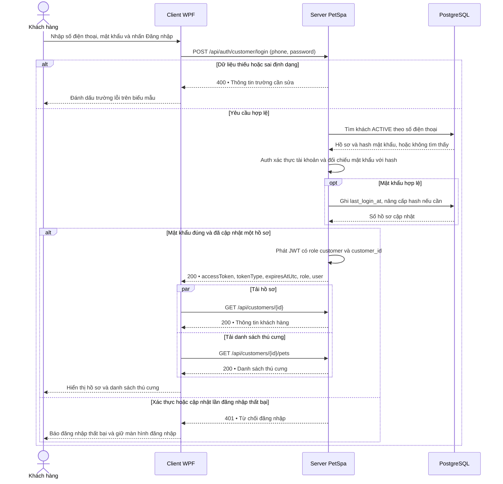

`id` ở hai lệnh GET là `user.id` trong kết quả login. WPF gửi `Authorization: Bearer <accessToken>` cho cả hai. Hai lệnh đọc độc lập. Nếu một lệnh lỗi mạng, giữ phần đã tải và cho thử lại phần lỗi. `200 []` ở danh sách thú cưng hiển thị “Chưa có thú cưng”.

<a id="cus-01"></a>

## CUS-01 · Xem và sửa hồ sơ khách hàng

**Bắt buộc · API đã có**  
**Người tham gia** — Khách hàng (hồ sơ của mình), lễ tân, quản lý

Khách mở trang cá nhân bằng ID trong phiên. Tại quầy, lễ tân hoặc quản lý chọn khách từ danh sách đang hoạt động.

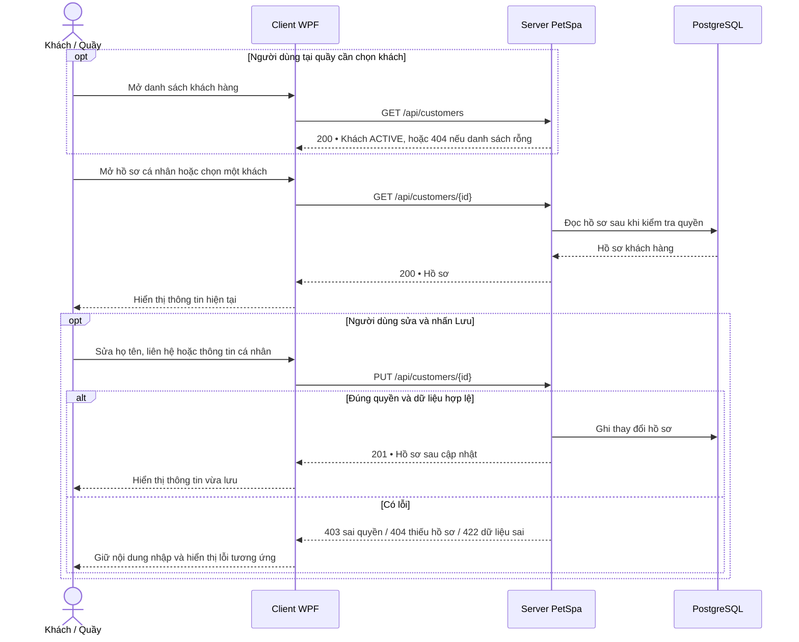

`PUT` hiện trả `201` kèm hồ sơ đã lưu. Màn hình tự phục vụ chỉ gửi thông tin cá nhân được sửa. Quyền đổi trạng thái được bàn riêng ở CUS-05. `note` trên hồ sơ khách không cập nhật `specialNote` của thú cưng.

<a id="cus-02"></a>

## CUS-02 · Xem và cập nhật hồ sơ thú cưng

**Bắt buộc · API kết hợp**  
**Người tham gia** — Khách xem thú cưng của mình. Lễ tân và quản lý được sửa hồ sơ theo quyền.

Khách có thể đọc ghi chú chăm sóc trong hồ sơ của thú cưng. Quyền thay đổi specialNote thuộc riêng lễ tân.

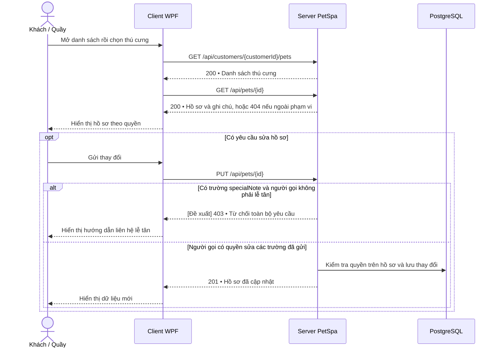

Hiện PUT nhận specialNote và kiểm tra quyền theo chủ hồ sơ. Thiết kế mới yêu cầu kiểm tra role và sự xuất hiện của trường trước khi ghi, kể cả specialNote = null hoặc đi kèm trường hợp lệ. Trường note của khách và note của lịch đặt là dữ liệu riêng.

<a id="cus-03"></a>

## CUS-03 · Thêm khách hàng

**Bắt buộc · API đã có**  
**Người tham gia** — Lễ tân, quản lý

Tạo hồ sơ khách ACTIVE cùng mật khẩu để khách có thể đăng nhập bằng số điện thoại.

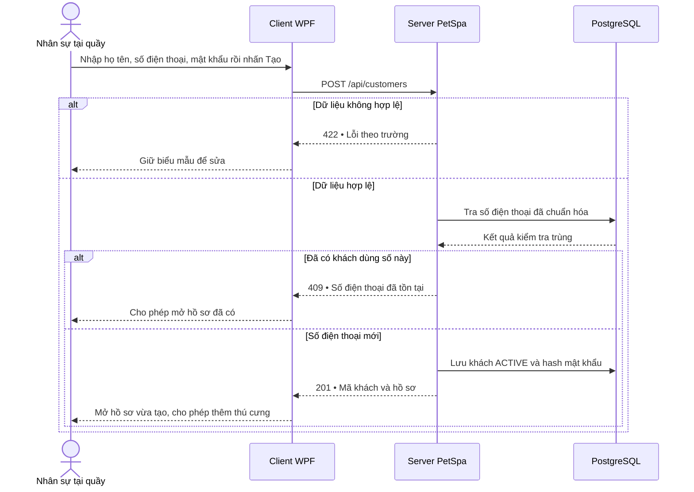

Số điện thoại trùng được xử lý bằng `409`. Khi người dùng chọn mở hồ sơ cũ, WPF dùng danh sách của CUS-01 để tìm và mở khách tương ứng.

<a id="cus-04"></a>

## CUS-04 · Thêm thú cưng cho khách

**Bắt buộc · API kết hợp**  
**Người tham gia** — Lễ tân, quản lý

Tại hồ sơ khách đang hoạt động, tạo thú cưng và nối đúng chủ sở hữu.

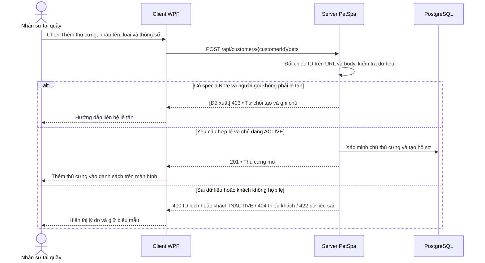

Body dùng trường `customersId` (có chữ s). ID này phải bằng `customerId` trên URL. API hiện cho cả chủ sở hữu gọi POST, rộng hơn vai trò của CUS-04.

<a id="cus-05"></a>

## CUS-05 · Vô hiệu hóa khách hàng hoặc thú cưng

**Mở rộng · API kết hợp**  
**Người tham gia** — Lễ tân, quản lý

Ngừng sử dụng một hồ sơ và giữ lại lịch sử booking đã gắn với hồ sơ đó.

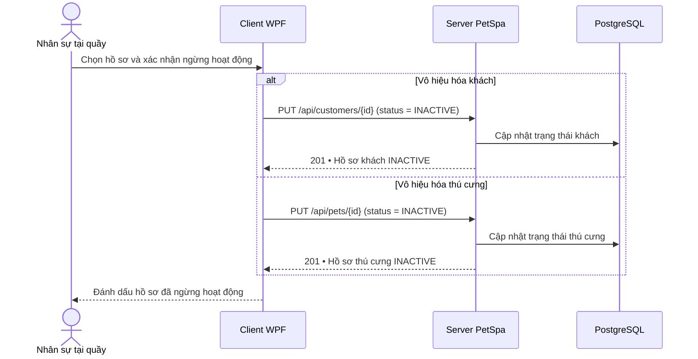

Hai PUT hiện chấp nhận `status` qua quyền truy cập chủ sở hữu. Theo use case, chỉ vai trò quản lý hồ sơ được đổi trạng thái. Login kiểm tra ACTIVE. Contract đặt lịch hiện chỉ kiểm tra quan hệ sở hữu, còn thiếu điều kiện ACTIVE của khách và thú cưng.

<a id="cus-06"></a>

## CUS-06 · Đăng nhập tại quầy

**Bắt buộc · API đã có**  
**Người tham gia** — Lễ tân, quản lý

Cùng API đăng nhập nội bộ với nhân viên thực hiện dịch vụ. Sau xác thực, quầy có thể mở màn hình tiếp nhận khách.

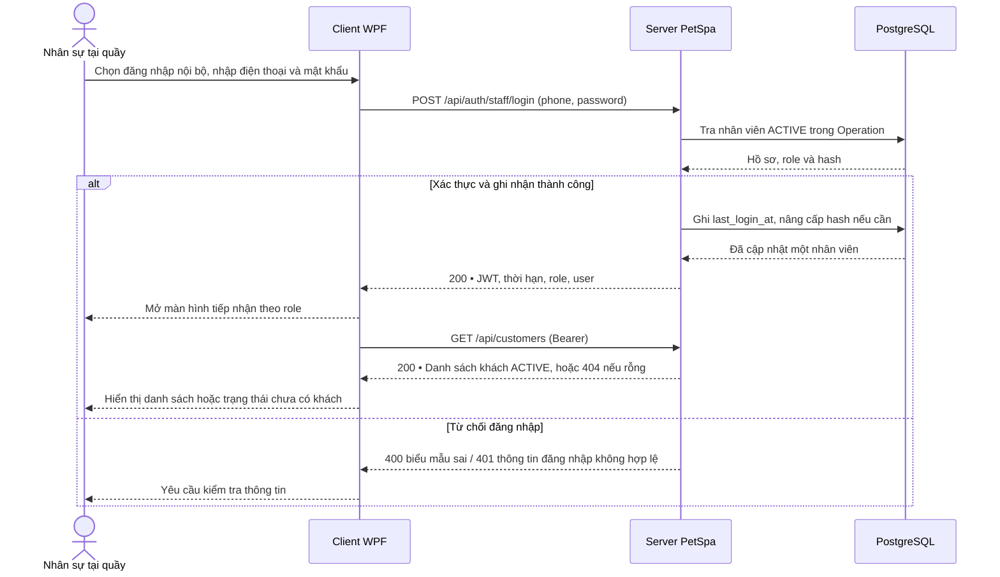

Token chứa `sub`, `account_type`, `role` và `staff_id`. Auth xác minh hash qua kho Operation rồi ghi lần đăng nhập trước khi phát JWT. Role lấy từ server. Tài khoản `admin` cũng dùng route này.

<a id="res-01"></a>

## RES-01 · Xem và quản lý danh mục dịch vụ

**Bắt buộc · API đã có**  
**Người tham gia** — Quản lý (đọc và ghi), khách hàng (chỉ xem)

Chọn danh mục, dịch vụ hoặc tùy chọn giá. Mỗi cấp có cùng mẫu thao tác quản lý.

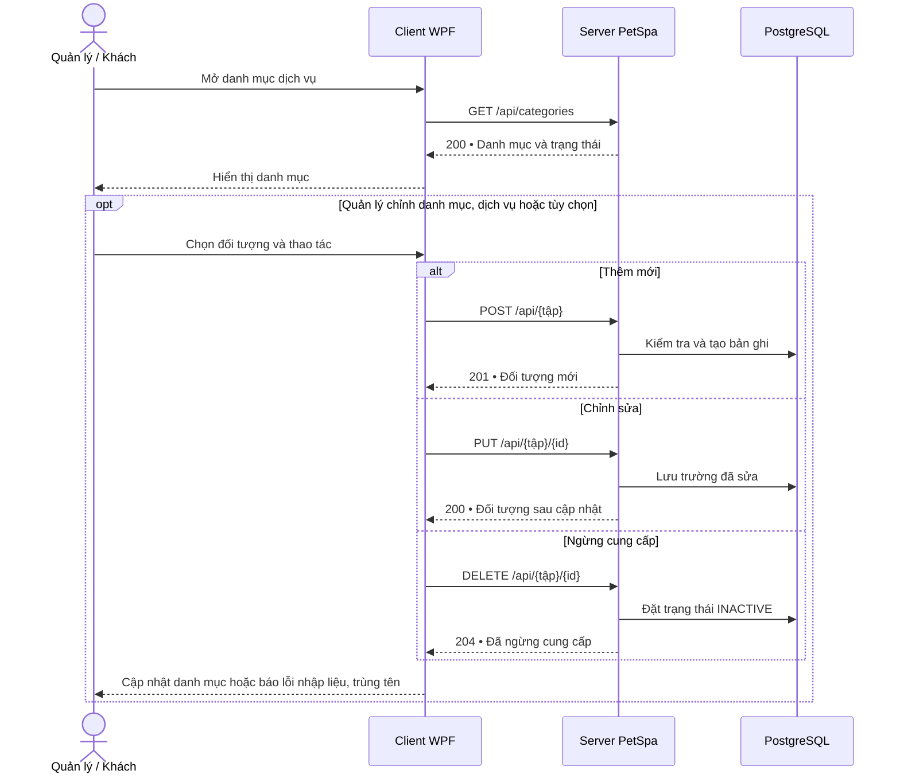

Trong sơ đồ, `{tập}` là `categories`, `services` hoặc `service-options`. Mỗi tập có GET danh sách/chi tiết, POST, PUT, DELETE. Các GET là công khai. Endpoint ghi hiện dùng `StaffOnly`, rộng hơn quyền Manager trong use case.

<a id="res-02"></a>

## RES-02 · Tìm dịch vụ và chọn tùy chọn phù hợp

**Bắt buộc · API đã có**  
**Người tham gia** — Khách hàng, lễ tân, quản lý

Tra cứu theo danh mục và từ khóa. Chọn tùy chọn theo loài, khoảng cân nặng, thời lượng và giá.

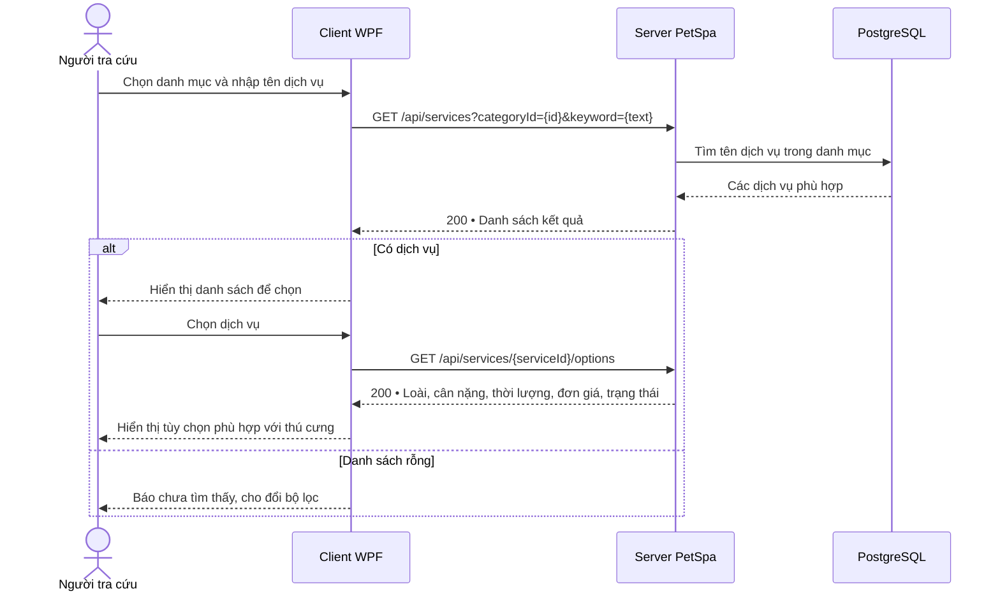

GET danh sách hiện có thể trả cả dữ liệu INACTIVE. Màn hình chọn để đặt lịch lọc các cấp ACTIVE. Khi ghi booking, server kiểm tra lại trạng thái và lấy đơn giá qua Resource Contract.

<a id="book-01"></a>

## BOOK-01 · Tạo lịch đặt

**Bắt buộc · API kết hợp**  
**Người tham gia** — Lễ tân, quản lý

Quầy đã chọn khách, thú cưng, giờ hẹn và ít nhất một tùy chọn dịch vụ qua CUS-01/02 và RES-02.

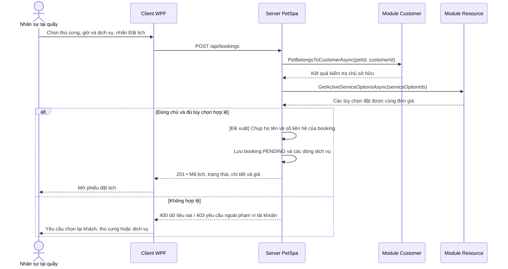

Thiết kế mới lưu họ tên và số điện thoại liên hệ vào booking để BOOK-03 có thể thay đổi riêng cho lịch này. WPF gửi `customerId`, `petId`, `bookingTime` ở UTC, `serviceOptionIds` và `note`. Server lưu giá từng tùy chọn vào `booking.booking_details.unit_price`. Phòng và nhân viên được bố trí khi bàn giao ở OPS-11.

<a id="book-02"></a>

## BOOK-02 · Thay đổi dịch vụ trong lịch đặt

**Bắt buộc · API kết hợp**  
**Người tham gia** — Lễ tân, quản lý

Mã hiện tại cho thay dịch vụ ở PENDING hoặc CONFIRMED. Theo thiết kế mới, quầy chốt danh sách khi bàn giao nhóm phiên. WPF gửi toàn bộ danh sách muốn giữ.

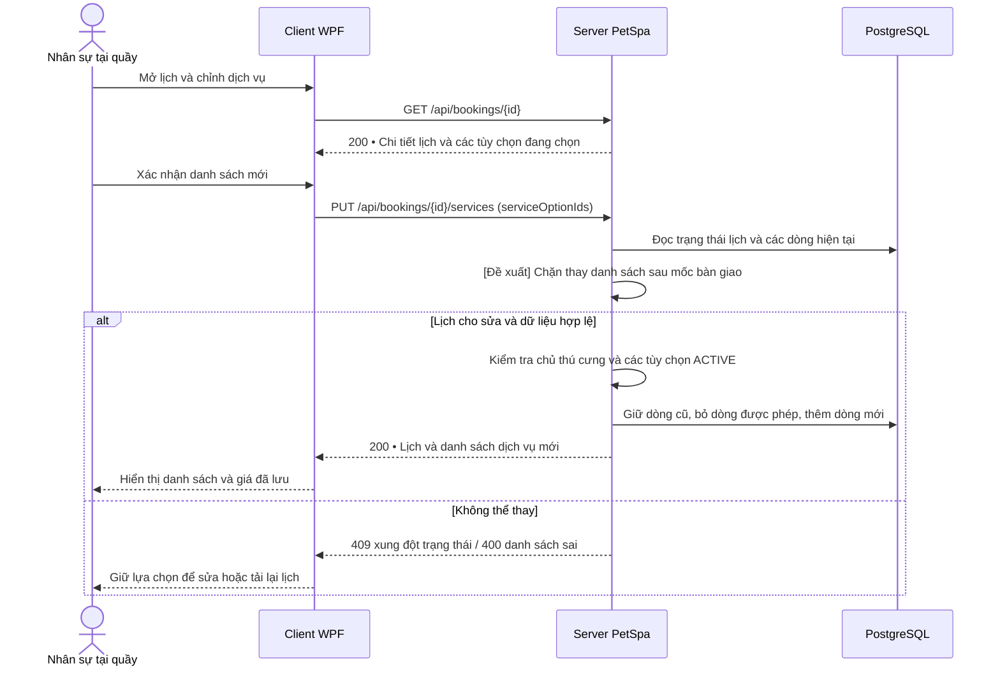

Server giữ giá của dòng cũ và lấy giá hiện tại cho dòng thêm mới. Hiện tại các dòng bị bỏ được xóa nếu chưa WORKING/COMPLETED. Theo thiết kế mới, khi đã có phiên, bỏ dịch vụ qua OPS-13 để hủy các phân công và giữ lịch sử, đồng thời cố định tập dòng đã bàn giao. Không thay đổi dịch vụ qua PUT thông tin chung của BOOK-03.

<a id="book-03"></a>

## BOOK-03 · Cập nhật thông tin lịch đặt

**Bắt buộc · API kết hợp**  
**Người tham gia** — Lễ tân, quản lý

Tách việc sửa giờ hẹn, liên hệ và ghi chú khỏi các thao tác thay dịch vụ, xác nhận và hủy lịch.

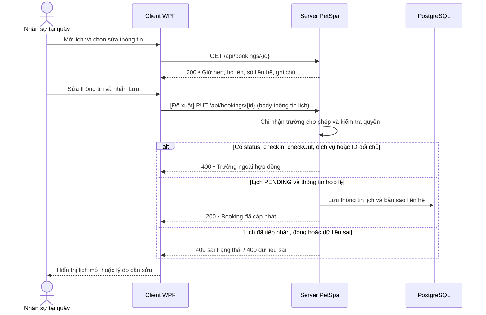

Body đề xuất gồm bookingTime, contactName, contactPhone, note. Tên và số điện thoại là bản sao liên hệ của riêng booking, khởi tạo từ hồ sơ khách khi tạo lịch. Cần thêm hai trường, xử lý dữ liệu cũ và thay DTO hiện yêu cầu status. WPF cũ và server cần đổi hợp đồng đồng bộ.

<a id="book-04"></a>

## BOOK-04 · Hủy lịch đặt tại quầy

**Bắt buộc · API đề xuất**  
**Người tham gia** — Lễ tân, quản lý

Quầy hủy lịch chưa bàn giao. Với lịch đã bàn giao, chỉ cho phép hủy khi toàn bộ dòng trong nhóm đã được hủy ở Operation.

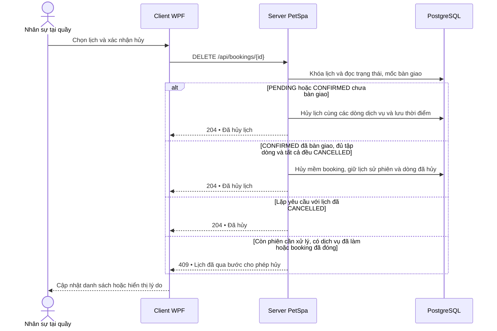

Booking khóa lịch, kiểm tra trạng thái các dòng đã được Operation đồng bộ và ghi `CANCELLED` đúng một lần. Mốc `sessionsCreatedAt` phân biệt lịch chưa bàn giao với nhóm đã bàn giao. Nhóm rỗng hoặc thiếu dòng cần đối soát. Nhóm đã hủy toàn bộ kết thúc ở đây và không lập hóa đơn.

<a id="book-05"></a>

## BOOK-05 · Tìm lịch đặt và mở chi tiết tại quầy

**Bắt buộc · API kết hợp**  
**Người tham gia** — Lễ tân, quản lý

Tìm booking theo ngày, trạng thái, mã khách hoặc số liên hệ đã lưu trên lịch. Nhân viên phòng mở công việc từ danh sách phiên được giao.

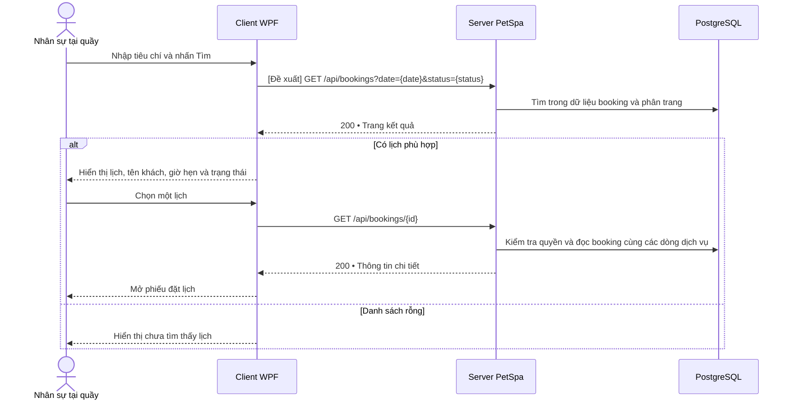

GET chi tiết theo ID đã có. API tìm kiếm và việc giới hạn cả tìm kiếm lẫn xem chi tiết của màn hình nội bộ cho quầy là thiết kế mới. Với khách tự phục vụ, quyền xem dữ liệu của chính mình vẫn được kiểm tra ở server.

<a id="book-06"></a>

## BOOK-06 · Cập nhật trạng thái booking

**Bắt buộc · API đề xuất**  
**Người tham gia** — Lễ tân, quản lý

Khi khách đến, quầy xác nhận tiếp nhận. Khi nhóm phiên kết thúc, quầy chốt booking để Billing có thể lập hóa đơn. Hai thao tác dùng cùng một PATCH, mỗi yêu cầu chỉ gửi trường `status`.

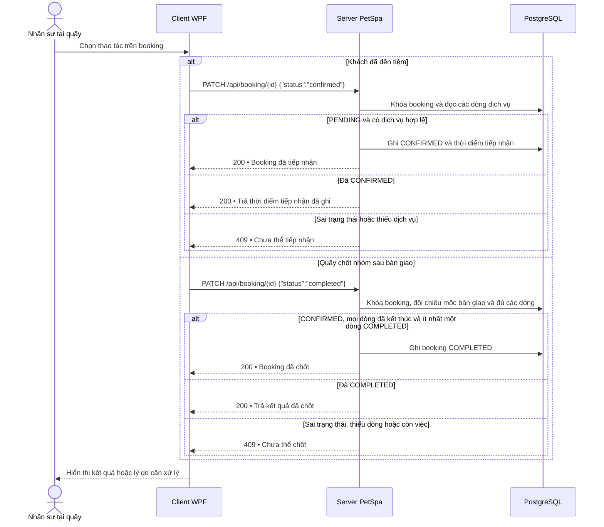

**Gọi cùng [BILL-01](#bill-01).** Khi chốt nhóm, chỉ lập hóa đơn sau khi PATCH `completed` thành công. Nếu mất phản hồi từ Billing, chỉ gửi lại BILL-01. Lần PATCH `confirmed` lúc khách đến kết thúc tại bước tiếp nhận. Hủy lịch qua BOOK-04. Chỉ Billing được yêu cầu `paid` ở BILL-03.

<a id="book-07"></a>

## BOOK-07 · Xem tổng hợp các lịch đặt

**Quy trình con · API kết hợp**  
**Người tham gia** — Lễ tân, quản lý

Mở danh sách booking của quầy theo quyền. Lần tải đầu không cần nhập tiêu chí. Người dùng có thể phân trang hoặc mở phiếu chi tiết.

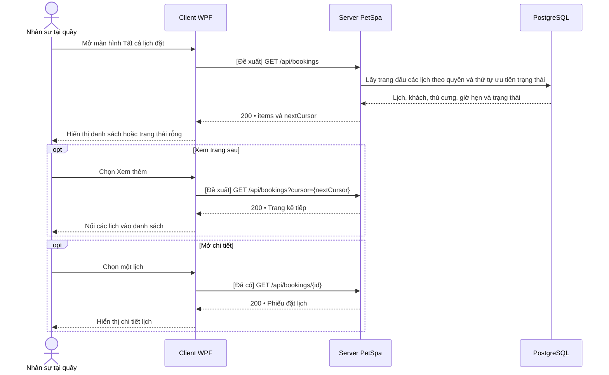

Ưu tiên hiển thị: `completed → confirmed → paid → pending → cancelled`. Server sắp xếp trước khi phân trang, tiếp theo là `bookingTime` tăng dần (giờ trống xếp cuối) và `id` tăng dần. Cursor mang đủ ba khóa sắp xếp. BOOK-05 dùng cùng thứ tự khi có bộ lọc.

<a id="ops-01"></a>

## OPS-01 · Quản lý phòng

**Mở rộng · API đề xuất**  
**Người tham gia** — Quản lý

Khai báo phòng, sửa tên/loại phòng hoặc đưa phòng vào bảo trì. Các route tra cứu theo khoảng giờ đã có. OPS-09 mô tả hợp đồng mới cho cả hiện tại và khoảng giờ.

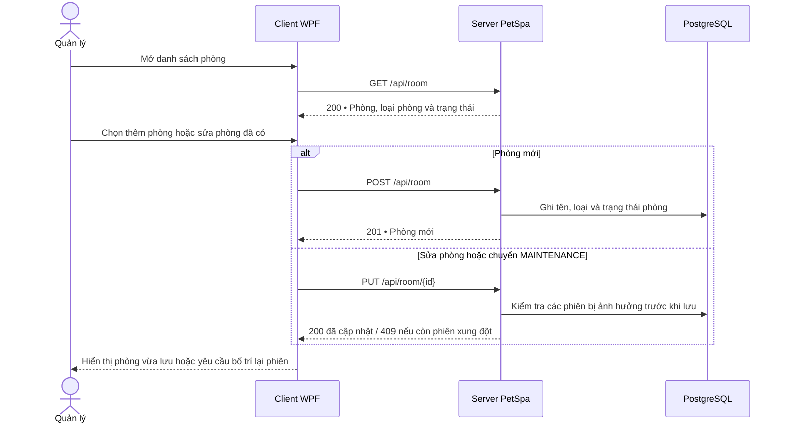

Dùng cùng tiền tố `/api/room` của module Operation. Khi đổi trạng thái, thiết kế kiểm tra phiên đang dùng phòng để quản lý có thể sắp xếp lại trước khi ngừng sử dụng.

<a id="ops-02"></a>

## OPS-02 · Xem, thêm, sửa và ngừng sử dụng nhân viên

**Mở rộng · API đề xuất**  
**Người tham gia** — Quản lý

Chọn một hàng để xem chi tiết nhân viên bằng ID. DELETE vô hiệu hóa tài khoản và giữ hồ sơ, lịch sử phân công.

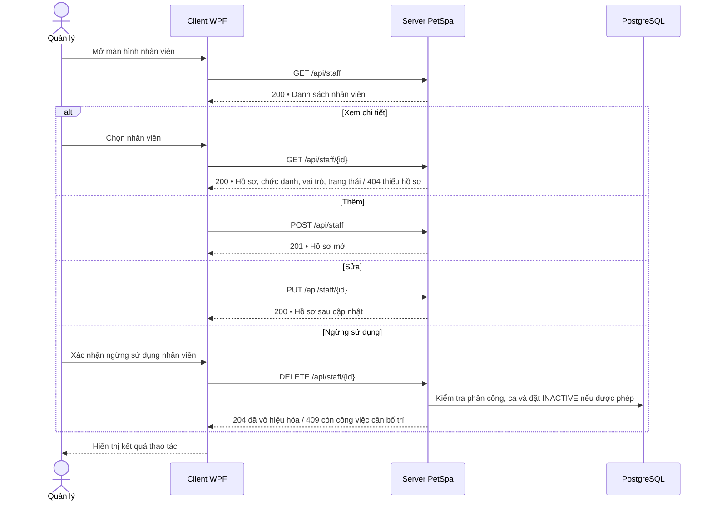

Khi tạo nhân viên, server kiểm tra trùng tài khoản và lưu hash mật khẩu. Quản lý chỉ được cấp các role trong phạm vi quyền của mình. DELETE trả 409 khi còn phiên hoặc ca cần bố trí lại, trả 204 khi đã INACTIVE. Login nội bộ hiện đã kiểm tra ACTIVE.

<a id="ops-03"></a>

## OPS-03 · Xem toàn bộ ca làm

**Mở rộng · API đề xuất**  
**Người tham gia** — Quản lý

Mở bảng ca theo trang, gồm ca đã xếp, đang làm, hoàn tất và đã hủy.

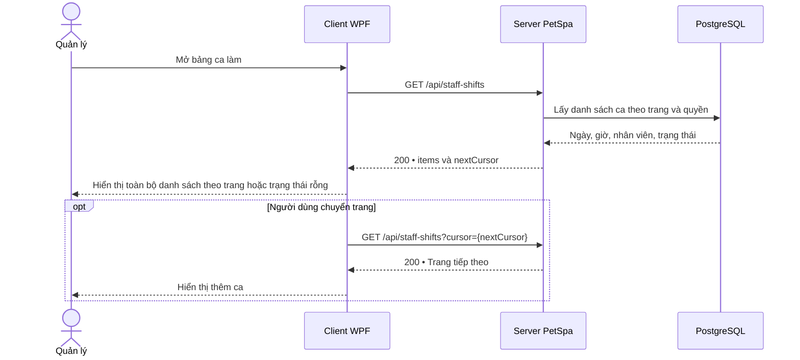

Các quy trình OPS-04 đến OPS-08 lần lượt mô tả lọc, tạo, sửa, hủy và ghi nhận vào/kết thúc ca. WORKING là trạng thái đề xuất bổ sung vào StaffShiftStatus và ràng buộc lưu trữ.

<a id="ops-04"></a>

## OPS-04 · Tìm ca làm theo tiêu chí

**Quy trình con · API đề xuất**  
**Người tham gia** — Quản lý

Lọc bảng ca theo ngày, nhân viên hoặc trạng thái. Chỉ gửi các tiêu chí người dùng đã chọn.

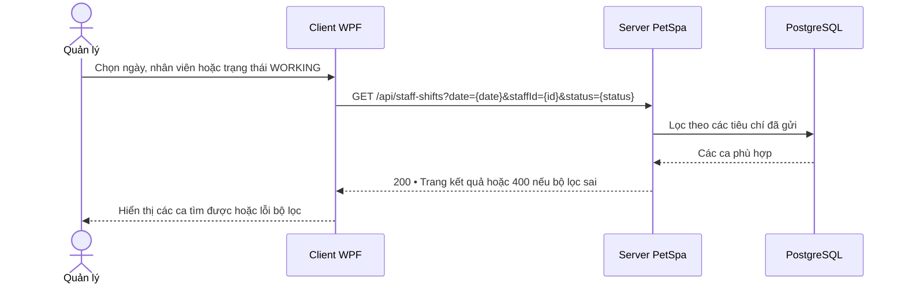

Trả 200 với items rỗng khi chưa có ca khớp. Khi bộ lọc thay đổi, WPF bắt đầu lại từ trang đầu.

<a id="ops-05"></a>

## OPS-05 · Tạo ca làm

**Quy trình con · API đề xuất**  
**Người tham gia** — Quản lý

Tạo ca cho nhân viên ACTIVE theo ngày và giờ tại tiệm.

```mermaid
sequenceDiagram
    actor NguoiDung as Quản lý
    participant Client as Client WPF
    participant Server as Server PetSpa
    participant DuLieu as PostgreSQL
    NguoiDung->>Client: Chọn nhân viên, ngày, giờ bắt đầu và kết thúc
    Client->>Server: POST /api/staff-shifts
    Server->>DuLieu: Kiểm tra nhân viên và các ca giao khoảng
    alt Ca hợp lệ
        Server->>DuLieu: Lưu ca SCHEDULED
        Server-->>Client: 201 • Ca làm mới
    else Dữ liệu sai hoặc trùng lịch
        Server-->>Client: 400 khoảng giờ sai / 409 trùng ca
    end
    Client-->>NguoiDung: Hiển thị kết quả trên lịch ca
```

Ca mới bắt đầu ở SCHEDULED. Server kiểm tra khoảng giờ trên cùng ngày và ca trùng của cùng nhân viên ngay lúc ghi.

<a id="ops-06"></a>

## OPS-06 · Điều chỉnh ca làm

**Quy trình con · API đề xuất**  
**Người tham gia** — Quản lý

Sửa ngày hoặc giờ của ca SCHEDULED và kiểm tra các phân công đang dựa vào ca đó.

```mermaid
sequenceDiagram
    actor NguoiDung as Quản lý
    participant Client as Client WPF
    participant Server as Server PetSpa
    participant DuLieu as PostgreSQL
    NguoiDung->>Client: Mở ca đã xếp và sửa ngày hoặc giờ
    Client->>Server: PUT /api/staff-shifts/{id}
    Server->>DuLieu: Kiểm tra trạng thái, ca trùng và các phiên đã giao
    alt SCHEDULED và đáp ứng các phân công
        Server->>DuLieu: Lưu thời gian mới
        Server-->>Client: 200 • Ca đã cập nhật
    else Đã vào ca hoặc có xung đột
        Server-->>Client: 409 • Lý do xung đột
    end
    Client-->>NguoiDung: Hiển thị ca vừa sửa hoặc phiên cần bố trí lại
```

Giữ mốc bắt đầu thực tế của ca WORKING. Khi ca mới khiến nhân viên mất khả dụng cho một phiên đã giao, trả 409 để quản lý bố trí lại.

<a id="ops-07"></a>

## OPS-07 · Hủy ca làm

**Quy trình con · API đề xuất**  
**Người tham gia** — Quản lý

Ngừng sử dụng một ca chưa bắt đầu bằng DELETE. Lịch sử nhân viên vẫn tra cứu được ca đã hủy.

```mermaid
sequenceDiagram
    actor NguoiDung as Quản lý
    participant Client as Client WPF
    participant Server as Server PetSpa
    participant DuLieu as PostgreSQL
    NguoiDung->>Client: Chọn ca và xác nhận Hủy
    Client->>Server: DELETE /api/staff-shifts/{id}
    Server->>DuLieu: Đọc trạng thái và các phân công bị ảnh hưởng
    alt SCHEDULED đủ điều kiện hoặc đã CANCELLED
        Server->>DuLieu: Đặt CANCELLED nếu đây là lần hủy đầu
        Server-->>Client: 204 • Đã hủy
    else Đang làm, đã hoàn tất hoặc còn phân công
        Server-->>Client: 409 • Ca chưa thể hủy
    end
    Client-->>NguoiDung: Làm mới bảng ca hoặc hiển thị lý do
```

Chỉ hủy ca SCHEDULED không còn phân công cần ca đó. Ca WORKING kết thúc qua quy trình OPS-08 để giữ giờ thực tế.

<a id="ops-08"></a>

## OPS-08 · Ghi nhận vào ca và kết thúc ca

**Quy trình con · API đề xuất**  
**Người tham gia** — Nhân viên của ca, quản lý được phép ghi nhận

Vòng đời ca là SCHEDULED → WORKING → COMPLETED. Từ SCHEDULED cũng có thể chuyển CANCELLED qua DELETE.

```mermaid
sequenceDiagram
    actor NguoiDung as Nhân viên / Quản lý
    participant Client as Client WPF
    participant Server as Server PetSpa
    participant DuLieu as PostgreSQL
    NguoiDung->>Client: Nhấn Vào ca
    Client->>Server: POST /api/staff-shifts/{id}/start
    Server->>DuLieu: Kiểm tra quyền và trạng thái, ghi WORKING cùng giờ vào
    Server-->>Client: 200 • Ca đang làm / 403 sai người / 409 sai trạng thái
    Client-->>NguoiDung: Hiển thị trạng thái ca
    opt Khi kết thúc ca WORKING
        NguoiDung->>Client: Nhấn Kết thúc ca
        Client->>Server: POST /api/staff-shifts/{id}/finish
        Server->>DuLieu: Kiểm tra phiên còn làm, ghi COMPLETED và giờ ra
        Server-->>Client: 200 • Ca hoàn tất / 409 còn phiên đang làm
        Client-->>NguoiDung: Hiển thị kết quả kết thúc ca
    end
```

WORKING phản ánh nhân viên thực sự vào ca. Giờ server ghi nhận một lần cho mỗi mốc. Server kiểm tra người gọi sở hữu ca hoặc có quyền quản lý. Lặp đúng thao tác trả kết quả đã ghi.

<a id="ops-09"></a>

## OPS-09 · Tra cứu phòng hiện tại hoặc theo khoảng giờ

**Bắt buộc · API đề xuất**  
**Người tham gia** — Lễ tân, quản lý

Tra ngay dùng đồng hồ server. Khi bố trí cho cả dịch vụ, quầy truyền giờ bắt đầu và kết thúc để kiểm tra phòng suốt khoảng đó.

```mermaid
sequenceDiagram
    actor NguoiDung as Nhân sự tại quầy
    participant Client as Client WPF
    participant Server as Server PetSpa
    participant DuLieu as PostgreSQL
    NguoiDung->>Client: Chọn danh sách phòng trống hoặc không khả dụng
    alt Tra phòng hiện tại
        Client->>Server: GET /api/room/available hoặc /api/room/unavailable
        Server->>Server: Chốt một thời điểm now theo đồng hồ server
        Server->>DuLieu: Xét trạng thái phòng và phiên chiếm phòng tại now
    else Tìm phòng trống theo khoảng yêu cầu
        Client->>Server: GET /api/room/available?startTime={t1}&endTime={t2}
        Server->>DuLieu: Tìm phòng AVAILABLE có thể dùng suốt khoảng từ t1 đến t2
    else Tìm phòng không khả dụng theo khoảng yêu cầu
        Client->>Server: GET /api/room/unavailable?startTime={t1}&endTime={t2}
        Server->>DuLieu: Tìm phòng bị khóa, bảo trì hoặc có phiên giao khoảng
    end
    Server-->>Client: 200 • Danh sách phòng đúng tiêu chí, có thể rỗng
    Client-->>NguoiDung: Hiển thị kết quả tại thời điểm hoặc khoảng đã chọn
```

Hai route mới dùng available/unavailable. Các route hiện có là /api/room/availability và /api/room/unavailability, đều bắt buộc startTime và endTime. Thiếu một mốc hoặc t1 ≥ t2 trả 400. Hai phòng dùng nối tiếp đúng mốc kết thúc không bị tính trùng.

<a id="ops-10"></a>

## OPS-10 · Tra nhân viên rảnh hoặc bận theo thời gian

**Bắt buộc · API đề xuất**  
**Người tham gia** — Lễ tân, quản lý

Tra hiện tại xét ca WORKING. Tra theo khoảng xét ca SCHEDULED hoặc WORKING bao phủ cả khoảng và phân công có thời gian giao nhau.

```mermaid
sequenceDiagram
    actor NguoiDung as Nhân sự tại quầy
    participant Client as Client WPF
    participant Server as Server PetSpa
    participant DuLieu as PostgreSQL
    NguoiDung->>Client: Chọn Rảnh/Bận và chế độ tra cứu
    alt Xem tại thời điểm hiện tại
        Client->>Server: GET /api/staff/available hoặc /api/staff/unavailable
        Server->>Server: Lấy giờ server tại lúc nhận yêu cầu
        Server->>DuLieu: Xét ca đang làm và phiên chiếm nhân viên tại thời điểm đó
    else Tra rảnh theo khoảng yêu cầu
        Client->>Server: GET /api/staff/available?startTime={t1}&endTime={t2}
        Server->>DuLieu: Lọc nhân viên ACTIVE, có ca bao phủ và không trùng phân công
    else Tra bận theo khoảng yêu cầu
        Client->>Server: GET /api/staff/unavailable?startTime={t1}&endTime={t2}
        Server->>DuLieu: Tìm phân công đang hiệu lực giao khoảng đã chọn
    end
    Server-->>Client: 200 • Danh sách nhân viên, có thể rỗng / 400 sai khoảng
    Client-->>NguoiDung: Hiển thị nhân viên và điều kiện tra cứu
```

Hai route cũ /api/staff/availability và /api/staff/unavailability yêu cầu cả hai mốc và trả 404 khi rỗng. Hợp đồng mới trả 200 với danh sách rỗng. Bận nghĩa là có phân công xung đột, còn ngoài ca là lý do không đủ điều kiện nhận việc. Thiếu một mốc hoặc khoảng sai trả 400.

<a id="ops-11"></a>

## OPS-11 · Tạo nhóm phiên dịch vụ trong Operation

**Bắt buộc · API đề xuất**  
**Người tham gia** — Lễ tân, quản lý

Khi bàn giao booking đã tiếp nhận, tạo một phiên WAITING cho mỗi dòng dịch vụ còn hiệu lực. Cả nhóm được ghi trong một giao dịch để danh sách tại quầy luôn có đủ phiên cần theo dõi.

```mermaid
sequenceDiagram
    actor NguoiDung as Nhân sự tại quầy
    participant Client as Client WPF
    participant Server as Server PetSpa
    participant Booking as Module Booking
    NguoiDung->>Client: Bố trí phòng và giờ cho các dòng dịch vụ
    Client->>Server: POST /api/service-sessions (bookingId, items)
    Server->>Booking: Khóa lịch, lấy các dòng còn hiệu lực và kiểm tra CONFIRMED
    Booking-->>Server: Tập dòng dịch vụ cần bàn giao
    alt Gửi lại đúng nhóm đã tạo
        Server-->>Client: 200 • Các mã phiên đã có
    else Khớp đủ dòng và phòng còn khả dụng
        Server->>Server: Tạo mỗi phiên với bookingId và bookingDetailId
        Server->>Booking: Ghi nhận thời điểm bàn giao và cố định danh sách dòng
        Booking-->>Server: Đã ghi trong cùng giao dịch
        Server-->>Client: 201 • Toàn bộ nhóm phiên WAITING
    else Thiếu dòng, sai booking hoặc trùng phòng
        Server-->>Client: 409 • Hủy giao dịch, chưa tạo phiên
    end
    Client-->>NguoiDung: Hiển thị nhóm phiên hoặc cho bố trí lại
```

Body đề xuất có bookingId và items gồm bookingDetailId, roomId, expectedStartAt, expectedFinishAt. Operation lưu booking_id trực tiếp trên mọi phiên. FK trỏ tới booking.booking(id) và FK ghép bảo đảm dòng dịch vụ thuộc đúng booking. Kiểm tra phòng và ghi mốc bàn giao cùng giao dịch với Booking Contract.

<a id="ops-12"></a>

## OPS-12 · Điều chỉnh phiên dịch vụ

**Quy trình con · API đề xuất**  
**Người tham gia** — Lễ tân, quản lý

Đổi phòng hoặc khoảng giờ dự kiến khi phiên còn WAITING. Đổi nhân viên thuộc quy trình điều chỉnh phân công.

```mermaid
sequenceDiagram
    actor NguoiDung as Nhân sự tại quầy
    participant Client as Client WPF
    participant Server as Server PetSpa
    participant DuLieu as PostgreSQL
    NguoiDung->>Client: Chọn phiên và sửa phòng hoặc giờ
    Client->>Server: PUT /api/service-sessions/{id}
    Server->>DuLieu: Đọc phiên, các phân công và lịch giao khoảng
    alt WAITING và mọi tài nguyên còn khả dụng
        Server->>DuLieu: Lưu phòng và khoảng giờ mới
        Server-->>Client: 200 • Chi tiết phiên sau cập nhật
    else Đã bắt đầu, hết hiệu lực hoặc có xung đột
        Server-->>Client: 409 • Lý do chưa thể lưu
    end
    Client-->>NguoiDung: Hiển thị phiên mới hoặc đề nghị bố trí lại
```

Operation kiểm tra lại khả dụng phòng và từng người đã nhận việc khi ghi. Khi có xung đột, toàn bộ phiên giữ cấu hình cũ. Việc đổi phòng hoặc giờ không làm phát sinh phiên thứ hai.

<a id="ops-13"></a>

## OPS-13 · Hủy phiên dịch vụ

**Quy trình con · API đề xuất**  
**Người tham gia** — Lễ tân, quản lý

Hủy riêng một phiên WAITING khi bỏ dịch vụ. Phòng và người thực hiện được giải phóng. Booking giữ trạng thái hiện tại cho tới khi quầy chốt.

```mermaid
sequenceDiagram
    actor NguoiDung as Nhân sự tại quầy
    participant Client as Client WPF
    participant Server as Server PetSpa
    participant Booking as Module Booking
    NguoiDung->>Client: Chọn phiên và xác nhận bỏ dịch vụ
    Client->>Server: DELETE /api/service-sessions/{id}
    alt Phiên WAITING
        Server->>Server: Ghi CANCELLED và hủy các phân công còn hiệu lực
        Server->>Booking: Đặt dòng dịch vụ tương ứng thành CANCELLED
        Booking-->>Server: Đã cập nhật dòng dịch vụ
        Server-->>Client: 204 • Đã hủy phiên
    else Phiên đã hủy
        Server-->>Client: 204 • Đã xử lý trước đó
    else Phiên đã làm hoặc đã hoàn thành
        Server-->>Client: 409 • Phiên đã qua bước cho phép hủy
    end
    Client-->>NguoiDung: Làm mới danh sách phiên
```

Operation cập nhật phiên, phân công và dòng booking qua contract trong cùng giao dịch. Khi đủ tập dòng bàn giao và mọi phiên đã kết thúc, OPS-22 mở BOOK-06 rồi BILL-01 nếu có dịch vụ hoàn thành. Nếu toàn bộ đều hủy, quầy chỉ dùng BOOK-04.

<a id="ops-14"></a>

## OPS-14 · Phân công và tự gửi thông báo lần đầu

**Bắt buộc · API đề xuất**  
**Người tham gia** — Lễ tân, quản lý phân công nhân viên

Khi ghi phân công thành công, server tự gọi nghiệp vụ thông báo đúng một lần cho nhân viên nhận việc. WPF chỉ gửi lệnh phân công.

```mermaid
sequenceDiagram
    actor NguoiDung as Nhân sự tại quầy
    participant Client as Client WPF
    participant Server as Server PetSpa
    participant ThongBao as Thông báo nội bộ
    NguoiDung->>Client: Chọn phiên WAITING và nhân viên đủ điều kiện
    Client->>Server: POST /api/service-sessions/{id}/assignments (staffId)
    Server->>Server: Kiểm tra ca, xung đột và quyền phân công
    alt Phân công mới
        Server->>Server: Tạo assignment cho nhân viên
        Server->>ThongBao: Tạo thông báo giao việc cho assignment mới
        ThongBao-->>Server: Thông báo chưa đọc đã ghi
        Server-->>Client: 201 • Phân công đã lưu và đã tạo thông báo
    else Gửi lại cùng yêu cầu đã thành công
        Server-->>Client: 200 • Phân công đã có
    else Nhân viên bận hoặc phiên không cho phân công
        Server-->>Client: 409 • Không ghi phân công
    end
    Client-->>NguoiDung: Hiển thị người nhận hoặc lý do xung đột
```

Ghi phân công và thông báo in-app trong cùng giao dịch, với khóa duy nhất theo sự kiện giao việc. Dùng lại cùng nghiệp vụ thông báo khi nhắc thủ công ở OPS-17. Mỗi lần đổi người là một sự kiện giao việc mới.

<a id="ops-15"></a>

## OPS-15 · Điều chỉnh phân công

**Quy trình con · API đề xuất**  
**Người tham gia** — Lễ tân, quản lý

Quầy đổi người phụ trách khi phiên còn WAITING. Người mới cần thuộc ca phù hợp và rảnh trong toàn bộ khoảng dự kiến.

```mermaid
sequenceDiagram
    actor NguoiDung as Nhân sự tại quầy
    participant Client as Client WPF
    participant Server as Server PetSpa
    participant ThongBao as Thông báo nội bộ
    NguoiDung->>Client: Chọn phân công và nhân viên thay thế
    Client->>Server: PUT /api/service-sessions/{id}/assignments/{assignmentId}
    Server->>Server: Kiểm tra phiên, liên kết assignment, ca và xung đột
    alt Người mới hợp lệ và khác người cũ
        Server->>Server: Cập nhật phân công, ghi lịch sử đổi người
        Server->>ThongBao: Ghi thông báo giao việc một lần cho người mới
        ThongBao-->>Server: Đã ghi cho đúng người nhận
        Server-->>Client: 200 • Phân công đã đổi
    else Cùng người đang phụ trách
        Server-->>Client: 200 • Phân công hiện tại
    else Không đủ điều kiện
        Server-->>Client: 409 • Giữ nguyên phân công cũ
    end
    Client-->>NguoiDung: Hiển thị người đang phụ trách
```

Lưu lịch sử đổi người, thu hồi quyền thao tác của người cũ và cập nhật danh sách việc. Chỉ tạo thông báo giao việc cho người mới khi người nhận thay đổi thực sự.

<a id="ops-16"></a>

## OPS-16 · Hủy phân công

**Quy trình con · API đề xuất**  
**Người tham gia** — Lễ tân, quản lý

Rút một nhân viên khỏi phiên còn WAITING. Nếu phiên hết người phụ trách, cần phân công lại trước khi bắt đầu.

```mermaid
sequenceDiagram
    actor NguoiDung as Nhân sự tại quầy
    participant Client as Client WPF
    participant Server as Server PetSpa
    participant DuLieu as PostgreSQL
    NguoiDung->>Client: Chọn người cần rút và xác nhận
    Client->>Server: DELETE /api/service-sessions/{id}/assignments/{assignmentId}
    Server->>DuLieu: Kiểm tra phân công thuộc phiên và trạng thái hiện tại
    alt WAITING và phân công đang hiệu lực
        Server->>DuLieu: Hủy phân công và giải phóng nhân viên
        Server-->>Client: 204 • Đã hủy
    else Phân công đã hủy
        Server-->>Client: 204 • Đã xử lý
    else Phiên đã bắt đầu hoặc kết thúc
        Server-->>Client: 409 • Phiên đã khóa phân công
    end
    Client-->>NguoiDung: Hiển thị danh sách nhân viên còn được giao
```

Operation vô hiệu hóa phân công và liên kết công việc của người cũ, lưu lịch sử ai đã từng được giao. Nhân viên mở thông báo cũ sẽ được kiểm tra lại quyền theo phân công hiện tại.

<a id="ops-17"></a>

## OPS-17 · Nhắc việc và nhận thông báo tự động

**Quy trình con · API đề xuất**  
**Người tham gia** — Nhân sự có quyền trên phiên gửi nhắc. Nhân viên được giao nhận thông báo.

Lễ tân, quản lý hoặc nhân viên được ủy quyền trên phiên có thể gửi nhắc nhiều lần. Người nhận do server xác định từ phân công còn hiệu lực.

```mermaid
sequenceDiagram
    actor NguoiDung as Người gửi nhắc
    participant Client as Client WPF
    participant Server as Server PetSpa
    participant ClientKhac as WPF nhân viên
    actor NhanVien as Nhân viên
    opt Người có quyền chủ động nhắc việc
        NguoiDung->>Client: Chọn phân công và nhấn Gửi nhắc
        Client->>Server: POST /api/service-sessions/{id}/notifications (assignmentId)
        Server->>Server: Kiểm tra quyền, phiên WAITING và khóa gửi lại
        Server-->>Client: 201 • Thông báo nhắc mới / 200 đã ghi cùng khóa / 403 sai quyền
        Client-->>NguoiDung: Hiển thị kết quả gửi
    end
    par Nhận thông báo nền
        loop Ngay sau đăng nhập và mỗi 30 giây khi còn phiên WPF
            ClientKhac->>Server: GET /api/me/notifications
            Server-->>ClientKhac: 200 • Thông báo của staff_id trong JWT
            ClientKhac-->>NhanVien: Cập nhật số chưa đọc và các thông báo mới
        end
    and Xử lý thao tác trên màn hình
        opt Người nhận mở một thông báo đã tải
            NhanVien->>ClientKhac: Chọn công việc
            ClientKhac->>Server: GET /api/service-sessions/{id}
            Server-->>ClientKhac: 200 • Chi tiết phiên / 403 nếu đã thu hồi phân công
            ClientKhac->>Server: PUT /api/me/notifications/{id}/read
            Server-->>ClientKhac: 204 • Đã đánh dấu đã đọc
        end
    end
```

GET chỉ đọc, POST tạo một lần nhắc mới cho mỗi thao tác có chủ ý. WPF dùng lại Idempotency-Key khi thử lại cùng lần nhấn. Đề xuất thăm dò mỗi 30 giây, dừng khi đăng xuất và bỏ qua nhịp nếu request trước chưa xong.

<a id="ops-18"></a>

## OPS-18 · Bắt đầu dịch vụ được giao

**Bắt buộc · API đề xuất**  
**Người tham gia** — Nhân viên được phân công

Nhân viên mở công việc và bắt đầu khi phiên đang WAITING, đã có phòng và đúng phân công.

```mermaid
sequenceDiagram
    actor NguoiDung as Nhân viên
    participant Client as Client WPF
    participant Server as Server PetSpa
    participant Booking as Module Booking
    participant DuLieu as PostgreSQL
    NguoiDung->>Client: Mở công việc và nhấn Bắt đầu
    Client->>Server: POST /api/service-sessions/{id}/start
    Server->>DuLieu: Đọc phiên, phòng, phân công và người thao tác
    alt Được giao, có phòng, đang WAITING
        Server->>DuLieu: Chuyển IN_PROGRESS và đặt startedAt
        Server->>Booking: Chuyển dòng dịch vụ sang WORKING trong cùng giao dịch
        Booking-->>Server: Đã đồng bộ dòng dịch vụ
        Server-->>Client: 200 • Phiên đang thực hiện và giờ bắt đầu
        Client-->>NguoiDung: Chuyển công việc sang Đang thực hiện
    else Gửi lại cùng lệnh
        Server-->>Client: 200 • Trạng thái và startedAt đã lưu
        Client-->>NguoiDung: Hiển thị thời gian bắt đầu cũ
    else Sai phân công hoặc điều kiện bắt đầu
        Server-->>Client: 403 sai người / 409 sai trạng thái hoặc thiếu phòng
        Client-->>NguoiDung: Hiển thị lý do, tải lại phiên
    end
```

`staff_id` đến từ JWT. Server đặt `startedAt` một lần. Nếu gửi lại cùng lệnh đã thành công, WPF nhận trạng thái hiện tại và giờ bắt đầu đã ghi.

<a id="ops-19"></a>

## OPS-19 · Lễ tân cập nhật ghi chú chăm sóc

**Mở rộng · API đề xuất**  
**Người tham gia** — Lễ tân ghi nhận yêu cầu của khách hoặc nhân viên chăm sóc

Khách và nhân viên phòng báo nội dung cho lễ tân. Lễ tân kiểm tra đúng thú cưng trước khi cập nhật specialNote.

```mermaid
sequenceDiagram
    actor NguoiDung as Lễ tân
    participant Client as Client WPF
    participant Server as Server PetSpa
    participant Customer as Module Customer
    NguoiDung->>Client: Chọn thú cưng và kiểm tra nội dung cần ghi
    Client->>Server: PUT /api/pets/{id}/special-note (specialNote)
    Server->>Server: Xác thực JWT và quyền receptionist
    alt Đúng lễ tân và được truy cập hồ sơ
        Server->>Customer: UpdatePetSpecialNote(petId, nội dung, người ghi)
        Customer->>Customer: Kiểm tra pet ACTIVE, độ dài và lưu ghi chú
        Customer-->>Server: Kết quả cập nhật
        Server-->>Client: 200 • Ghi chú mới / 404 thiếu pet / 409 pet ngừng hoạt động
        Client-->>NguoiDung: Hiển thị ghi chú vừa lưu
    else Tài khoản khách hoặc vai trò khác
        Server-->>Client: 403 • Chỉ lễ tân được sửa ghi chú chăm sóc
        Client-->>NguoiDung: Hiển thị hướng dẫn liên hệ lễ tân
    end
```

Customer sở hữu specialNote. Middleware và nghiệp vụ phải kiểm tra role receptionist ở mọi đường ghi, kể cả PUT thú cưng, trường trong body tạo hồ sơ và lệnh cập nhật theo phiên nếu có. Yêu cầu của người không có quyền bị từ chối trước khi ghi bất kỳ trường nào.

<a id="ops-20"></a>

## OPS-20 · Hoàn tất phiên dịch vụ

**Bắt buộc · API đề xuất**  
**Người tham gia** — Nhân viên được phân công

Nhân viên xác nhận xong phần việc của mình. Lễ tân nhìn thấy thay đổi ở lần làm mới màn hình phiên dịch vụ kế tiếp.

```mermaid
sequenceDiagram
    actor NguoiDung as Nhân viên
    participant Client as Client WPF
    participant Server as Server PetSpa
    participant Booking as Module Booking
    NguoiDung->>Client: Nhấn Hoàn thành trên công việc được giao
    Client->>Server: POST /api/service-sessions/{id}/complete
    alt Đúng phân công và phiên IN_PROGRESS
        Server->>Server: Lưu phiên COMPLETED và finishedAt
        Server->>Booking: Đặt riêng dòng dịch vụ tương ứng thành COMPLETED
        Booking-->>Server: Kết quả cập nhật dòng dịch vụ
        Server-->>Client: 200 • Phiên đã hoàn thành
    else Lặp lại đúng thao tác đã thành công
        Server-->>Client: 200 • Kết quả và thời điểm đã ghi
    else Sai người hoặc sai trạng thái
        Server-->>Client: 403 sai phân công / 409 sai trạng thái
    end
    Client-->>NguoiDung: Hiển thị kết quả công việc
```

Operation ghi finishedAt một lần và cập nhật dòng booking tương ứng qua contract trong cùng giao dịch. Booking cha tiếp tục CONFIRMED đến khi lễ tân bấm nút chốt. Nếu ghi dòng dịch vụ thất bại, hoàn tác giao dịch để client có thể gửi lại.

<a id="ops-21"></a>

## OPS-21 · Nhân viên đăng nhập và nhận danh sách việc

**Bắt buộc · API kết hợp**  
**Người tham gia** — Nhân viên thực hiện dịch vụ

Nhân viên dùng cùng API với quầy. WPF lấy role trả về để mở màn hình công việc và chỉ tải phiên, thông báo của tài khoản đang đăng nhập.

```mermaid
sequenceDiagram
    actor NguoiDung as Nhân viên
    participant Client as Client WPF
    participant Server as Server PetSpa
    participant DuLieu as PostgreSQL
    NguoiDung->>Client: Nhập số điện thoại, mật khẩu và nhấn Đăng nhập
    Client->>Server: POST /api/auth/staff/login (phone, password)
    Server->>DuLieu: Tìm hồ sơ nhân viên ACTIVE
    DuLieu-->>Server: Role và hash mật khẩu
    alt Mật khẩu đúng, ghi nhận đăng nhập thành công
        Server->>DuLieu: Ghi last_login_at, nâng cấp hash nếu cần
        DuLieu-->>Server: Đã cập nhật
        Server-->>Client: 200 • accessToken, expiresAtUtc, role, user
        par Tải công việc bằng Bearer
            Client->>Server: [Đề xuất] GET /api/me/service-sessions
            Server-->>Client: 200 • Các phiên được giao
            Client-->>NguoiDung: Hiển thị các phiên được giao
        and Khởi động theo dõi thông báo bằng Bearer
            loop Ngay khi đăng nhập và mỗi 30 giây đến lúc đăng xuất
                Client->>Server: [Đề xuất] GET /api/me/notifications
                Server-->>Client: 200 • Thông báo của nhân viên
                Client-->>NguoiDung: Cập nhật thông báo chưa đọc
            end
        end
    else Yêu cầu sai hoặc xác thực thất bại
        Server-->>Client: 400 biểu mẫu sai / 401 đăng nhập thất bại
        Client-->>NguoiDung: Giữ màn hình đăng nhập
    end
```

Login đã có. Hai API `/api/me/...` đề xuất suy ra người nhận từ `staff_id`. Đây là cùng vòng thăm dò của OPS-17. Lỗi tải công việc được xử lý ở màn hình công việc, độc lập với kết quả xác thực.

<a id="ops-22"></a>

## OPS-22 · Theo dõi phiên dịch vụ, gom theo booking

**Bắt buộc · API đề xuất**  
**Người tham gia** — Lễ tân, quản lý

Màn hình lấy các phiên hiện tại từ Operation và hiển thị theo bookingId, gồm cả các phiên đã hoàn thành hoặc hủy thuộc cùng nhóm.

```mermaid
sequenceDiagram
    actor NguoiDung as Nhân sự tại quầy
    participant Client as Client WPF
    participant Server as Server PetSpa
    participant DuLieu as PostgreSQL
    NguoiDung->>Client: Mở màn hình Phiên dịch vụ tại quầy
    loop Tải ngay và mỗi 15 giây khi màn hình còn mở
        Client->>Server: GET /api/service-sessions/current
        Server->>DuLieu: Lấy nhóm hiện tại và mọi phiên trong từng nhóm
        DuLieu-->>Server: booking_id, phiên, trạng thái, phòng và người thực hiện
        Server->>Server: Đếm WAITING, IN_PROGRESS, COMPLETED, CANCELLED theo booking_id
        Server-->>Client: 200 • Danh sách nhóm và số phiên theo trạng thái
        alt Đủ tập phiên bàn giao, tất cả kết thúc và có ít nhất một phiên COMPLETED
            Client-->>NguoiDung: Mở thao tác chốt hoặc lập tiếp hóa đơn theo trạng thái booking
        else Đủ tập phiên bàn giao, mọi phiên đều CANCELLED
            Client-->>NguoiDung: Báo nhóm đã kết thúc và mở BOOK-04 để hủy booking
        else Còn phiên đang chờ, đang làm hoặc thiếu phiên bàn giao
            Client-->>NguoiDung: Hiển thị các phiên còn việc và khóa nút
        end
    end
```

Quầy lấy cả nhóm chuyển ca/ngày và phân trang theo bookingId trước khi tải phiên. Đối chiếu đủ tập dòng đã bàn giao. Booking CONFIRMED đủ điều kiện mở BOOK-06 rồi BILL-01. Booking đã COMPLETED nhưng chưa có hóa đơn chỉ mở BILL-01. Tra hóa đơn hiệu lực qua contract Billing để đưa nhóm đã lập hóa đơn ra khỏi hàng chờ. Nhóm hủy toàn bộ rời hàng chờ sau BOOK-04. Chỉ báo một lần cho mỗi nhóm sẵn sàng.

<a id="bill-01"></a>

## BILL-01 · Tạo hóa đơn

**Bắt buộc · API đề xuất**  
**Người tham gia** — Lễ tân, quản lý

Billing lập hóa đơn cho các dòng dịch vụ đã hoàn thành, theo giá đã lưu trên booking. Mỗi booking có tối đa một hóa đơn hiệu lực.

```mermaid
sequenceDiagram
    actor NguoiDung as Nhân sự tại quầy
    participant Client as Client WPF
    participant Server as Server PetSpa
    participant Booking as Module Booking
    participant Resource as Module Resource
    participant DuLieu as PostgreSQL
    NguoiDung->>Client: Lập hóa đơn cho booking đã chốt
    Client->>Server: POST /api/invoices (bookingId)
    Server->>DuLieu: Tìm hóa đơn hiệu lực theo bookingId
    alt Đã có hóa đơn hiệu lực
        Server-->>Client: 200 • Trả hóa đơn hiện có
    else Chưa có hóa đơn
        Server->>Booking: Lấy trạng thái và các dòng COMPLETED cùng đơn giá đã chốt
        Booking-->>Server: Dữ liệu lập hóa đơn
        alt Booking COMPLETED và có dòng đủ điều kiện
            Server->>Resource: Tra mô tả dịch vụ cho từng dòng
            Resource-->>Server: Mô tả cho snapshot
            Server->>DuLieu: Lưu hóa đơn UNPAID và các dòng trong một giao dịch
            Server-->>Client: 201 hóa đơn mới hoặc 200 nếu quầy khác đã tạo
        else Chưa chốt hoặc thiếu dữ liệu tính tiền
            Server-->>Client: 409 • Chưa thể lập hóa đơn
        end
    end
    Client-->>NguoiDung: Mở hóa đơn hoặc hiển thị lý do
```

**Gọi cùng [BOOK-06](#book-06).** Khi chốt nhóm, quầy gọi PATCH `completed` thành công rồi mới POST hóa đơn. Nếu POST lỗi, booking vẫn COMPLETED và có thể thử lại BILL-01. Loại dòng CANCELLED khỏi tiền dịch vụ. Khóa duy nhất theo bookingId cho hóa đơn còn hiệu lực bảo vệ cả khi hai quầy cùng bấm.

<a id="bill-02"></a>

## BILL-02 · Áp dụng giảm giá

**Mở rộng · API đề xuất**  
**Người tham gia** — Quản lý

Quản lý áp dụng số tiền giảm trên hóa đơn UNPAID trước lúc thu tiền. Mức giảm mặc định bằng 0.

```mermaid
sequenceDiagram
    actor NguoiDung as Quản lý
    participant Client as Client WPF
    participant Server as Server PetSpa
    participant DuLieu as PostgreSQL
    NguoiDung->>Client: Mở hóa đơn và nhập số tiền giảm
    Client->>Server: PUT /api/invoices/{id}/discount (discountAmount)
    Server->>Server: Kiểm tra quyền quản lý
    Server->>DuLieu: Đọc trạng thái và subtotal hiện tại
    alt UNPAID và mức giảm từ 0 đến subtotal
        Server->>DuLieu: Ghi mức giảm và tính lại totalAmount
        Server-->>Client: 200 • Tạm tính, giảm giá và tổng phải thu
        Client-->>NguoiDung: Hiển thị số tiền mới trước khi thanh toán
    else Sai quyền, số tiền hoặc trạng thái
        Server-->>Client: 403 sai quyền / 422 mức giảm sai / 409 hóa đơn đã đóng
        Client-->>NguoiDung: Hiển thị lý do, giữ tổng tiền hiện có
    end
```

Server tính `totalAmount = subtotal - discountAmount`. Chọn giảm theo số tiền, đúng trường `DiscountAmount` của model. Đặt lại cùng mức giảm không làm giảm thêm lần nữa.

<a id="bill-03"></a>

## BILL-03 · Ghi nhận thanh toán

**Bắt buộc · API đề xuất**  
**Người tham gia** — Lễ tân, quản lý

Quầy ghi nhận toàn bộ số tiền đã nhận bằng tiền mặt hoặc chuyển khoản. Billing gọi contract Booking với mã booking lấy từ hóa đơn. Máy chủ trả biên nhận sau khi cả hai module đã ghi thành công.

```mermaid
sequenceDiagram
    actor NguoiDung as Nhân sự tại quầy
    participant Client as Client WPF
    participant Server as Server PetSpa
    participant Booking as Module Booking
    participant DuLieu as PostgreSQL
    NguoiDung->>Client: Mở hóa đơn cần thu
    Client->>Server: GET /api/invoices/{id}
    Server-->>Client: 200 • Hóa đơn và tổng phải thu
    NguoiDung->>Client: Chọn phương thức, nhập số tiền và xác nhận đã nhận
    Client->>Server: POST /api/invoices/{id}/payments + Idempotency-Key
    Server->>DuLieu: Billing mở giao dịch, khóa hóa đơn và tra khóa chống lặp
    alt Cùng khóa và nội dung với giao dịch đã commit
        Server-->>Client: 200 • Biên nhận đã ghi
    else Hóa đơn UNPAID, khoản thu mới bằng tổng phải thu
        Server->>DuLieu: Ghi Payment SUCCESS, paidAt và Invoice PAID
        Server->>Booking: Contract PATCH /api/booking/{bookingId} {"status":"paid"}
        Booking->>DuLieu: Chuyển COMPLETED sang PAID trong cùng giao dịch
        alt Booking đã ghi PAID cho đúng lần thu
            Booking-->>Server: Đã cập nhật booking
            Server->>DuLieu: Commit giao dịch
            Server-->>Client: 201 • Biên nhận, hóa đơn và booking PAID
        else Booking từ chối hoặc gặp lỗi lưu dữ liệu
            Server->>DuLieu: Rollback cả lần ghi nhận
            Server-->>Client: 409 sai trạng thái / 503 lỗi tạm thời
        end
    else Sai số tiền, xung đột khóa hoặc hóa đơn đã đóng
        Server-->>Client: 422 sai số tiền / 409 xung đột
    end
    Client-->>NguoiDung: Hiển thị biên nhận hoặc kết quả để đối soát
```

Quầy gửi `amount`, `paymentMethod` và `transactionReference` nếu có. Billing truyền `invoice.bookingId` vào nghiệp vụ PATCH `/api/booking/{id}` với `{"status":"paid"}`. Nếu mất phản hồi hoặc gặp lỗi tạm thời, đối soát rồi gửi lại cùng `Idempotency-Key` và nội dung để lấy biên nhận. Lần gửi lại chỉ ghi nhận số tiền đã nhận.

<a id="bill-04"></a>

## BILL-04 · Tìm và xem hóa đơn

**Bắt buộc · API đề xuất**  
**Người tham gia** — Lễ tân, quản lý

Tìm theo mã booking, trạng thái hoặc thời gian. Chi tiết cho biết dịch vụ đã tính tiền, mức giảm và các khoản đã thu.

```mermaid
sequenceDiagram
    actor NguoiDung as Nhân sự tại quầy
    participant Client as Client WPF
    participant Server as Server PetSpa
    participant DuLieu as PostgreSQL
    NguoiDung->>Client: Chọn tiêu chí rồi nhấn Tìm hóa đơn
    Client->>Server: GET /api/invoices?bookingId={id}&status={status}
    Server->>DuLieu: Tìm hóa đơn theo bộ lọc và phân trang
    Server-->>Client: 200 • Trang kết quả
    alt Có hóa đơn
        Client-->>NguoiDung: Hiển thị danh sách
        NguoiDung->>Client: Chọn một hóa đơn
        Client->>Server: GET /api/invoices/{id}
        Server->>DuLieu: Đọc invoice, invoice_item và payment
        Server-->>Client: 200 • Dòng tiền và thanh toán / 404 nếu không còn hồ sơ
        Client-->>NguoiDung: Hiển thị chi tiết, cho phép in khi tải thành công
    else Danh sách rỗng
        Client-->>NguoiDung: Hiển thị chưa tìm thấy và giữ bộ lọc
    end
```

WPF dùng dữ liệu snapshot từ hóa đơn để hiển thị và in. API danh sách trả kết quả phân trang, gồm mã hóa đơn, mã booking, tổng tiền và trạng thái.

<a id="e2e-01"></a>

## E2E-01 · Từ tiếp nhận đến chốt nhóm phiên và thu tiền

**Tổng hợp · API kết hợp**  
**Người tham gia** — Lễ tân, quản lý và nhân viên thực hiện dịch vụ

Lễ tân tiếp nhận, bố trí phiên và chốt nhóm. Nhân viên phòng nhận việc, bắt đầu và kết thúc phiên được giao.

```mermaid
sequenceDiagram
    actor NguoiDung as Nhân sự tại quầy
    participant Client as WPF tại quầy
    participant Server as Server PetSpa
    participant Booking as Module Booking
    participant ClientKhac as WPF nhân viên
    actor NhanVien as Nhân viên
    NguoiDung->>Client: Tạo booking cho khách và thú cưng
    Client->>Server: POST /api/bookings
    Server-->>Client: 201 • Booking PENDING
    NguoiDung->>Client: Khi khách đến, xác nhận tiếp nhận
    Client->>Server: PATCH /api/booking/{id} với body {"status":"confirmed"}
    Server-->>Client: 200 • Booking CONFIRMED
    NguoiDung->>Client: Bố trí phiên rồi phân công nhân viên
    Client->>Server: Tạo nhóm phiên và phân công (OPS-11, OPS-14)
    Server-->>Client: Nhóm WAITING và thông báo giao việc
    NhanVien->>ClientKhac: Mở công việc, bắt đầu rồi hoàn tất phiên
    ClientKhac->>Server: Cập nhật phiên được giao (OPS-18, OPS-20)
    Server-->>ClientKhac: Phiên COMPLETED
    loop Màn hình quầy mở, mỗi 15 giây
        Client->>Server: GET /api/service-sessions/current
        Server-->>Client: Các nhóm phiên theo bookingId
    end
    Client-->>NguoiDung: Báo nhóm đã xong và bật nút Chốt và tạo hóa đơn
    NguoiDung->>Client: Chốt trạng thái completed và tạo hóa đơn
    Client->>Server: PATCH /api/booking/{id} với body {"status":"completed"}
    Server-->>Client: 200 • Booking COMPLETED
    Client->>Server: POST /api/invoices (bookingId của nhóm đã chốt)
    Server-->>Client: 201 hóa đơn mới / 200 hóa đơn đã có
    Client-->>NguoiDung: Hiển thị hóa đơn và số tiền cần thu
    NguoiDung->>Client: Xác nhận đã nhận tiền
    Client->>Server: POST /api/invoices/{id}/payments
    Server->>Booking: Billing gọi contract PATCH /api/booking/{bookingId} {"status":"paid"}
    Booking-->>Server: Booking PAID
    Server-->>Client: 201 • Đã commit, trả biên nhận và trạng thái PAID
```

Màn hình quầy lấy phiên từ Operation theo bookingId. Khi mọi phiên kết thúc và có ít nhất một dịch vụ hoàn thành, WPF báo cho lễ tân và chờ thao tác chủ động. Khi nhóm phiên hoàn tất, quầy gọi BOOK-06 để chốt `COMPLETED` rồi BILL-01 để tạo hóa đơn; đây là hai quy trình riêng được gọi nối tiếp. Sau khi có hóa đơn, thu tiền theo BILL-03; nếu thanh toán thành công thì Billing tiếp tục gọi contract sang Booking để cập nhật trạng thái `PAID`.

## Nguồn đối chiếu

- [UseCase.docx](docs/Base/UseCase.docx) — danh mục, actor, đặc tả, BR01–BR14 và kịch bản demo.
- [Program.cs](src/PetSpa.Api/Program.cs), [AuthEndpoints.cs](src/PetSpa.Modules/Auth/Endpoints/AuthEndpoints.cs), [LoginService.cs](src/PetSpa.Modules/Auth/Application/LoginService.cs) và [chính sách quyền](src/PetSpa.Modules/Auth/Infrastructure/Authorization/AuthorizationRegistration.cs) — route đã map, kết quả đăng nhập và role.
- [Customer](src/PetSpa.Modules/Customer/Endpoints), [Resource](src/PetSpa.Modules/Resource/Endpoints), [BookingService.cs](src/PetSpa.Modules/Booking/Application/Services/BookingService.cs), [OperationModule.cs](src/PetSpa.Modules/Operation/OperationModule.cs) và [Billing](src/PetSpa.Modules/Billing) — đối chiếu endpoint, điều kiện và trạng thái hiện hành.
- [Migration liên kết phiên với booking](src/PetSpa.Modules/Operation/Infrastructure/Persistence/Migrations/20261118155509_LinkServiceSessionToBooking.cs) — thêm khóa ngoại vật lý, điền booking_id cho dữ liệu cũ và chặn sai cặp booking/dòng dịch vụ. Các route mới, mốc bàn giao và thao tác chốt hai bước trong sơ đồ là hợp đồng đề xuất.
- [Enum BookingStatus](src/PetSpa.Modules/Booking/Domain/Enums/BookingStatus.cs) và [cấu hình Booking](src/PetSpa.Modules/Booking/Infrastructure/Persistence/Configurations/BookingConfiguration.cs) — repo chưa khai báo PAID, CHECK còn cho phép CHECKED_IN. Kiểm tra catalog PostgreSQL ở từng môi trường trước khi đồng bộ migration.
